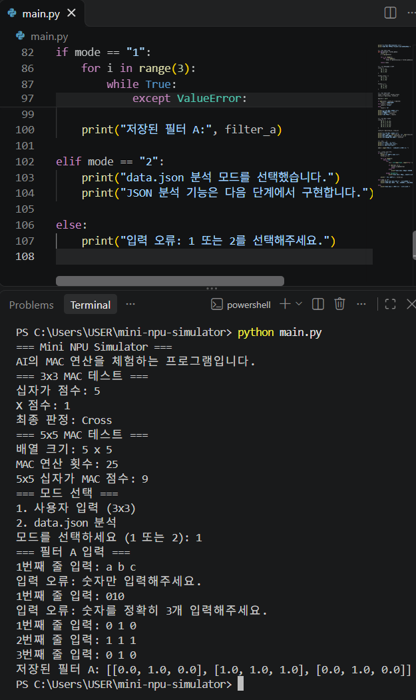
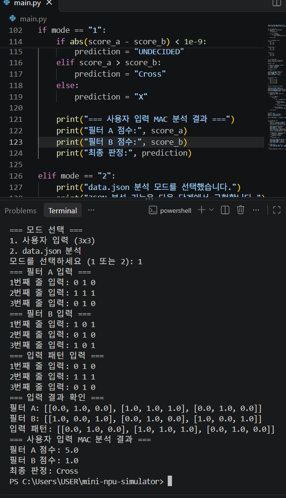
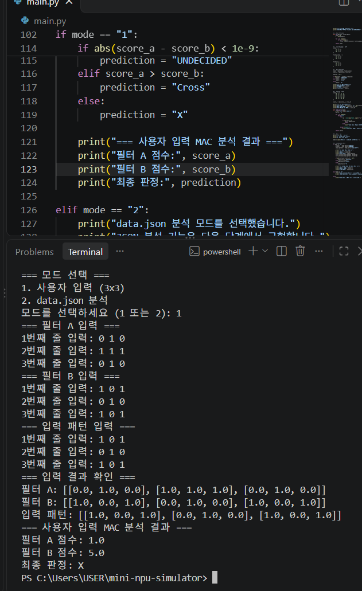
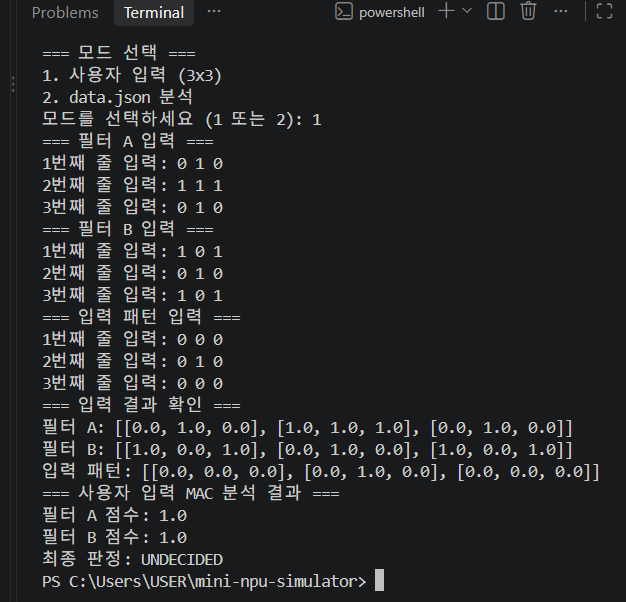
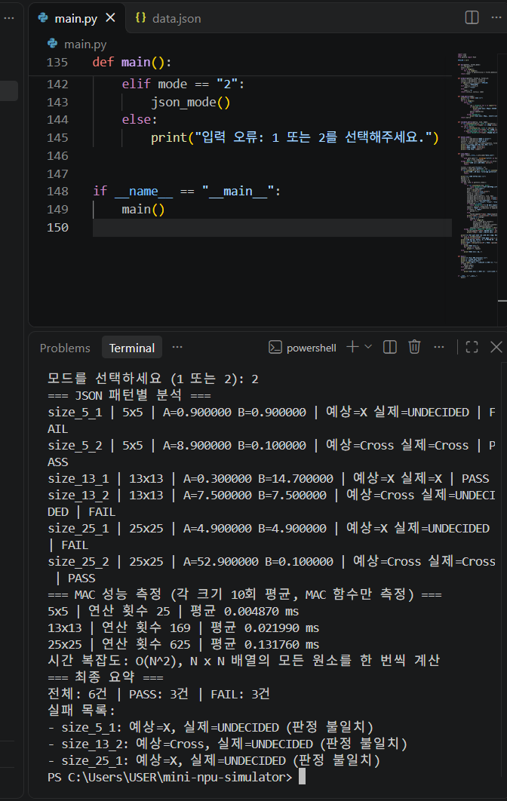

# Mini NPU Simulator — 코디세이 3주차 미션

## 1. 프로젝트 소개
Python으로 NPU의 핵심 연산인 MAC(Multiply-Accumulate, 곱셈-누적)을 구현하고, 십자가(Cross)와 X 패턴을 비교·분류하는 콘솔 프로그램입니다. 외부 연산 라이브러리 없이 이중 반복문으로 2차원 배열의 원소별 곱을 누적합니다.

## 2. 실행 환경 및 파일
- 실행 환경: Windows, VS Code, Python 3.x
- `main.py`: MAC 연산, 사용자 입력, JSON 분석, 판정, 성능 측정
- `data.json`: 5×5·13×13·25×25 필터 및 테스트 패턴
- 실행 명령: `python main.py`

## 3. 사용 방법
1. `main.py`와 `data.json`을 같은 폴더에 둡니다.
2. 터미널에서 `python main.py`를 실행합니다.
3. `1`을 선택하면 필터 A(Cross), 필터 B(X), 입력 패턴을 각각 3행씩 입력합니다. 한 행에 숫자 3개를 공백으로 구분합니다.
4. `2`를 선택하면 `data.json`에 있는 패턴 6건을 자동 분석합니다.

## 4. 데이터 구조
JSON의 `filters`에는 크기별 `size_5`, `size_13`, `size_25` 필터가 있고, 각 크기에 `cross`, `x` 필터가 있습니다. `patterns`의 각 항목에는 2차원 배열 `input`과 기대 정답 `expected`가 있습니다. 기대 정답 `+`는 `Cross`, `x`는 `X`로 정규화하여 비교합니다.

## 5. MAC 계산 및 판정 원리
`MAC = Σ(pattern[i][j] × filter[i][j])`입니다. 두 필터의 점수를 계산하고, 점수 차의 절댓값이 `1e-9` 미만이면 내부적으로 `UNDECIDED` (모드1 출력: `판정 불가`, 모드2 출력: `UNDECIDED`), 그렇지 않으면 높은 점수의 필터를 선택합니다. 소수점 연산의 미세한 오차를 고려한 비교 방식입니다. 사용자 입력 모드에서 필터 A는 Cross, 필터 B는 X로 취급합니다.

## 6. 입력 오류 처리
3×3 사용자 입력 시 행마다 숫자 3개인지 검사합니다. 문자 등 숫자로 변환할 수 없는 입력은 `try/except ValueError`로 처리하며, 잘못된 입력은 재입력을 요청합니다.

## 7. JSON 테스트 결과
2026-11-19 실행 화면 기준, 총 6건 중 PASS 3건, FAIL 3건입니다.

| 패턴 | 기대값 | 실제 판정 | 결과 |
|---|---|---|---|
| size_5_1 | X | UNDECIDED | FAIL |
| size_5_2 | Cross | Cross | PASS |
| size_13_1 | X | X | PASS |
| size_13_2 | Cross | UNDECIDED | FAIL |
| size_25_1 | X | UNDECIDED | FAIL |
| size_25_2 | Cross | Cross | PASS |

FAIL은 프로그램 오류가 아니라, MAC 점수의 동점 또는 허용 오차 이내의 차이로 `UNDECIDED`가 반환되어 JSON의 기대값과 불일치한 사례입니다. 실패 건도 목록과 사유를 출력하도록 구현했습니다.

## 8. MAC 성능 측정
각 크기에 대해 MAC 함수만 10회 반복 실행하고 `time.perf_counter()`로 측정한 시간을 밀리초(ms) 단위로 환산해 평균을 구했습니다. 측정값은 실행 환경에 따라 달라집니다.

| 크기 | 원소별 MAC 횟수(N²) | 10회 평균(ms) |
|---|---:|---:|
| 5×5 | 25 | 0.004870 |
| 13×13 | 169 | 0.021990 |
| 25×25 | 625 | 0.131760 |

N×N 배열을 이중 반복문으로 한 번 순회하므로 시간 복잡도는 **O(N²)**입니다. 크기가 증가할수록 계산해야 하는 원소 수가 제곱으로 증가합니다. 실제 시간은 OS 스케줄링 및 측정 오버헤드에도 영향을 받으므로 N²와 정확히 같은 비율로 증가하지는 않습니다.

## 9. 트러블슈팅
- **IndentationError**: `try`와 `except`의 들여쓰기 수준이 맞지 않아 발생했습니다. 코드 블록을 공백 4칸 단위로 정리해 해결했습니다.
- **PowerShell 명령 오류**: Python 프로그램의 입력 대기 상태가 아닌 PowerShell 프롬프트에 `a b c`를 입력해 오류가 났습니다. 먼저 `python main.py`를 실행한 뒤 프로그램이 입력을 요청할 때 값을 입력하도록 수정했습니다.
- **잘못된 파일 실행**: Downloads 폴더의 새 `main.py`와 프로젝트 폴더의 기존 `main.py`가 별도로 열려 있어 이전 코드가 실행됐습니다. 새 코드를 프로젝트의 `main.py`에 복사하고 저장해 해결했습니다.

## 10. 실습 증빙 이미지
이미지는 프로젝트의 `screenshots/` 폴더를 기준으로 표시합니다.

### 사용자 입력 및 오류 처리


### 3×3 패턴 자동 판정


### X 패턴 판정


### 동점 판정


### JSON 자동 분석 및 성능 측정


> 이미지 경로는 실제 저장 위치와 일치해야 합니다.

## 11. 보너스 과제 — 구현 계획 및 검증 방법

> 아래 두 기능은 선택 과제의 설계이며, 현재 확인된 main.py에는 아직 구현되어 있지 않습니다. 성능 비교 결과는 구현 후 실제 측정값으로 기록합니다.

### 11-1. 시뮬레이터 최적화 (메모리 접근)

- 기존 방식: `pattern[i][j]`와 `filter_data[i][j]`를 이중 반복문으로 접근합니다.
- 개선 방식: 행 우선 순서로 2차원 배열을 길이 N²의 1차원 리스트로 변환하고, 단일 반복문으로 MAC을 계산합니다.
- 변환 인덱스: `k = i * N + j`.
- 두 방식의 시간 복잡도는 O(N²)로 동일하지만, 중첩 인덱싱 감소로 실행 시간이 달라질 수 있습니다. Python 리스트는 연속된 숫자 버퍼와 동일하지 않으므로 성능 향상을 보장하지 않습니다.

```python
def flatten(matrix):
    return [value for row in matrix for value in row]


def mac_flat(pattern, filter_data):
    if len(pattern) != len(filter_data):
        raise ValueError("배열 길이 불일치")
    total = 0.0
    for i in range(len(pattern)):
        total += pattern[i] * filter_data[i]
    return total
```

**성능 비교 계획**

동일 패턴과 필터를 사용하여 각 방식의 MAC을 100회씩 실행하고 `time.perf_counter()`로 평균 ms를 측정합니다. 배열 변환은 연산 전 수행하며, 변환 시간도 별도로 기록하여 일회성 실행 비용과 반복 실행 비용을 구분합니다. 두 결과의 차이가 EPSILON 미만인지 확인합니다.

| 크기 | 반복 횟수(각 방식) | 2차원 평균(ms) | 1차원 평균(ms) | 변환 시간(ms) |
|---|---:|---|---|---|
| 5×5 | 100 | 미측정 | 미측정 | 미측정 |
| 13×13 | 100 | 미측정 | 미측정 | 미측정 |
| 25×25 | 100 | 미측정 | 미측정 | 미측정 |

속도 향상률은 `(기존 평균 - 개선 평균) / 기존 평균 * 100`으로 계산합니다. 음수이면 개선 방식이 더 느린 것입니다. 변환 배열을 추가로 보관하면 O(N²)의 추가 공간이 필요합니다.

### 11-2. 패턴 생성기 개발

양의 정수 N을 입력받아 Cross와 X 필터를 자동 생성하는 함수를 설계합니다. 홀수 N에서는 중앙 행·열이 Cross를 구성하고, 두 대각선이 X를 구성합니다. 짝수 N에서는 Cross의 중앙 두 행·열을 사용하도록 정의합니다.

```python
def generate_patterns(n):
    if type(n) is not int or n < 1:
        raise ValueError("N은 양의 정수여야 합니다.")
    centers = {(n - 1) // 2, n // 2}
    cross = [[int(i in centers or j in centers)
              for j in range(n)] for i in range(n)]
    x = [[int(i == j or i + j == n - 1)
          for j in range(n)] for i in range(n)]
    return cross, x
```

N=5 예시:

```text
Cross       X
0 0 1 0 0   1 0 0 0 1
0 0 1 0 0   0 1 0 1 0
1 1 1 1 1   0 0 1 0 0
0 0 1 0 0   0 1 0 1 0
0 0 1 0 0   1 0 0 0 1
```

**재활용 및 테스트 계획**

- 모드1에 자동 필터 생성 선택지를 추가하고 기존 수동 입력도 유지합니다.
- 생성된 필터와 패턴을 기존 `predict()` 및 성능 측정 함수에 전달합니다.
- N=5에서 Cross 입력은 A=9, B=1, X 입력은 A=1, B=9가 되는지 검증합니다.
- N=1, 짝수 N, 잘못된 크기 입력 및 동점 처리도 검증합니다.
- 구현 후 성능 비교와 자동 생성 실행 화면을 증빙 이미지로 추가합니다.

## 12. 배운 점
2차원 배열, 중첩 반복문, 함수 재사용, 예외 처리, JSON 데이터 읽기, 기대값 비교, 부동소수점 오차 처리, 반복 성능 측정의 기본 원리를 익혔습니다. 특히 실행 성공과 테스트 기대값 일치는 서로 다른 검증 기준이라는 점을 확인했습니다.
