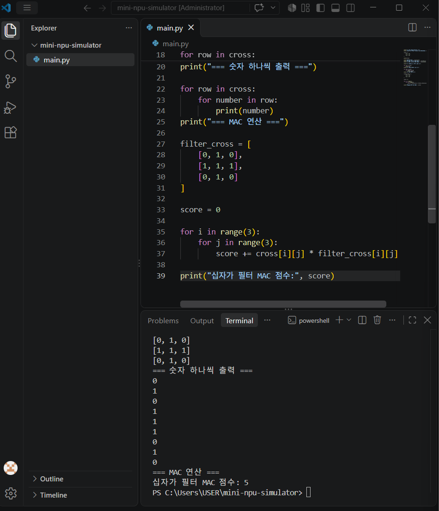
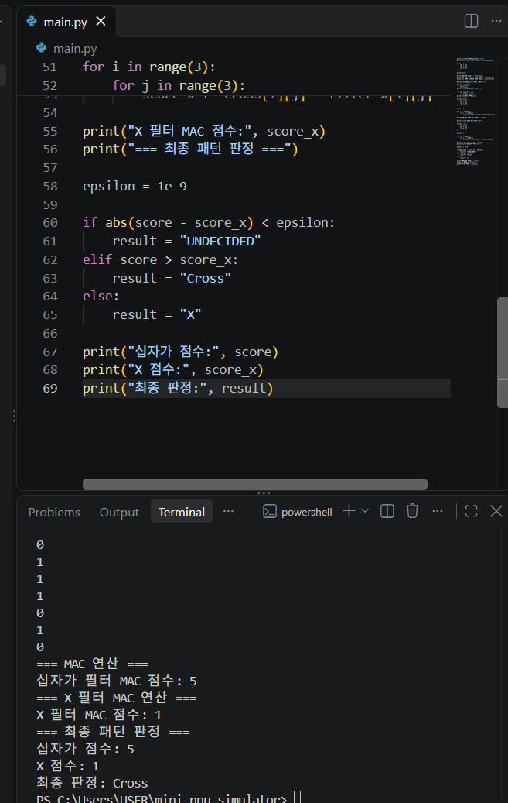
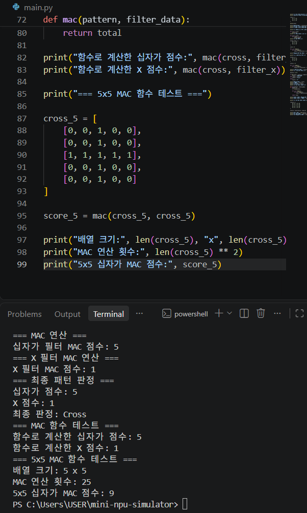
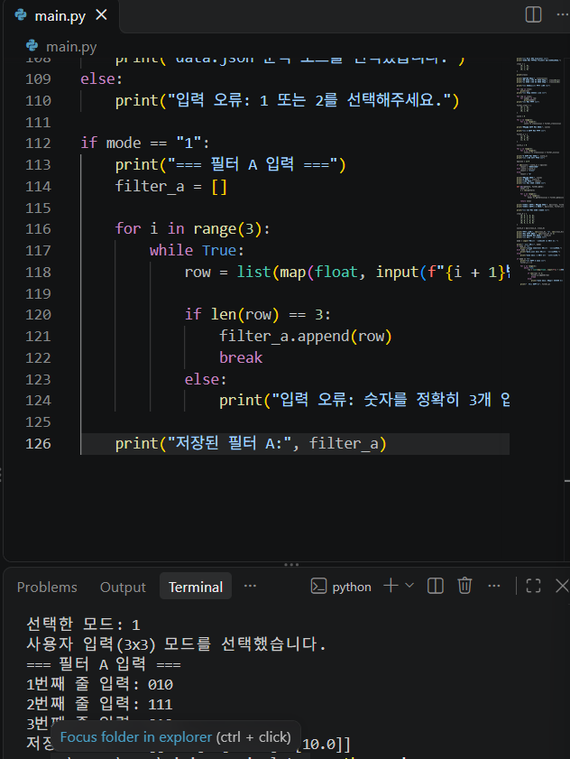
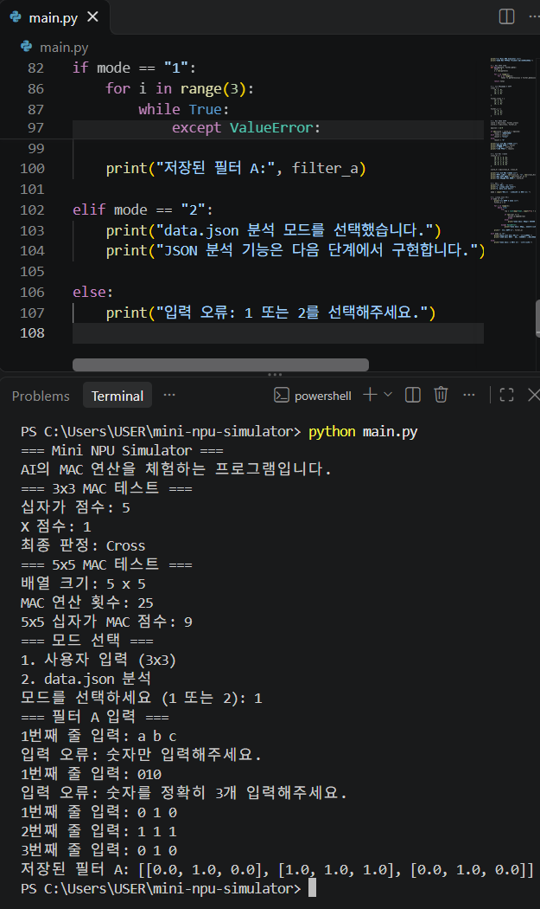
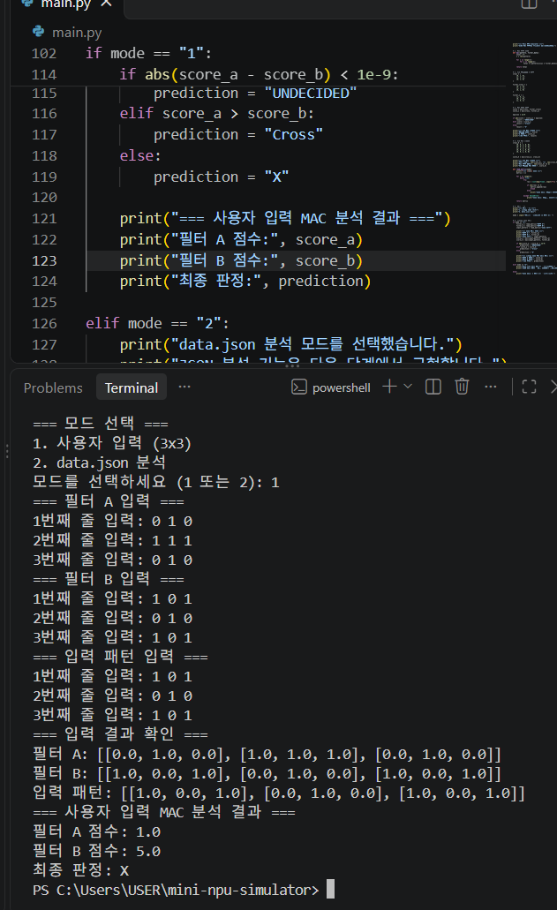
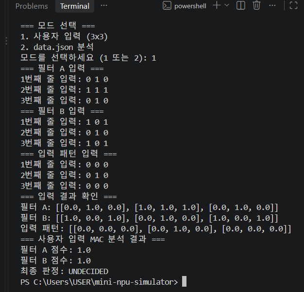
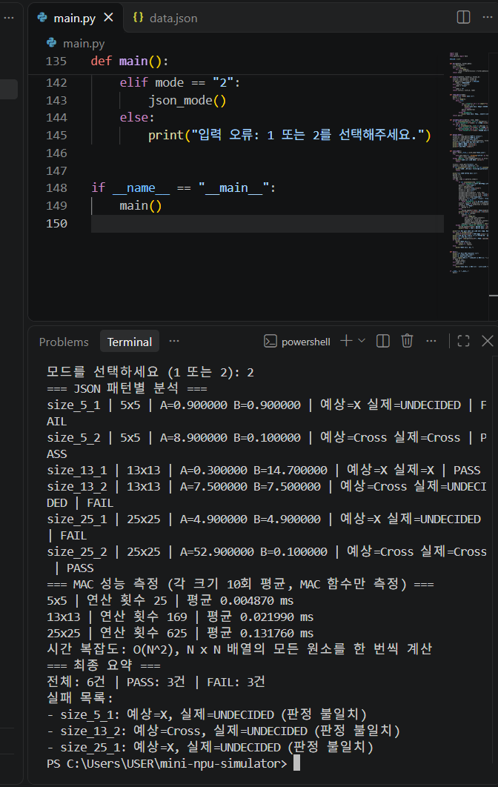

# Mini NPU Simulator — 코디세이 3주차 미션

## 1. 프로젝트 소개

Python으로 NPU의 핵심 연산인 MAC(Multiply-Accumulate, 곱셈-누적)을 구현하고, 십자가(Cross)와 X 패턴을 비교·분류하는 콘솔 프로그램입니다.

외부 연산 라이브러리 없이 이중 반복문을 사용하여 2차원 배열의 원소별 곱을 누적합니다.

## 2. 실행 환경 및 파일 구성

- 운영체제: Windows
- 개발 도구: Visual Studio Code
- 프로그래밍 언어: Python 3.x
- main.py: MAC 연산, 사용자 입력, JSON 분석, 패턴 판정, 성능 측정
- data.json: 5×5, 13×13, 25×25 필터 및 테스트 데이터
- screenshots/: 실습 과정 및 실행 결과 캡처

프로젝트 구조:

```text
mini-npu-simulator/
├── main.py
├── data.json
├── README.md
└── screenshots/
    ├── 03_MAC_연산_구현.png
    ├── 04_MAC_패턴_자동판정.png
    ├── 05_MAC_5x5_확장테스트.png
    ├── 06_입력값_개수검증_1.png
    ├── 06_입력값_개수검증_2.png
    ├── 07_문자입력_오류처리.png
    ├── 08_3x3_필터_패턴입력.png
    ├── 09_사용자입력_MAC_자동판정.png
    ├── 10_X패턴_MAC_판정.png
    ├── 11_UNDECIDED_동점판정.png
    └── 12_JSON_자동분석_성능측정.png
```

## 3. 프로그램 실행 방법

VS Code에서 프로젝트 폴더를 열고 터미널에 다음 명령어를 입력합니다.

```powershell
python main.py
```

프로그램은 두 가지 모드를 제공합니다.

### 모드 1: 사용자 입력 (3×3)

- 필터 A(Cross) 입력
- 필터 B(X) 입력
- 판별할 입력 패턴 입력
- 각 행에 숫자 3개를 공백으로 구분하여 입력
- MAC 점수를 비교하여 Cross, X, UNDECIDED 중 하나로 판정

### 모드 2: data.json 자동 분석

- data.json에서 필터와 패턴을 읽음
- 5×5, 13×13, 25×25 배열 분석
- 각 패턴의 MAC 점수 계산
- 예상 정답과 실제 판정 비교
- PASS/FAIL 및 실패 원인 출력
- 크기별 MAC 실행 시간 측정

## 4. JSON 데이터 구조

data.json은 filters와 patterns 등의 데이터를 포함합니다.

filters에는 다음 크기의 필터가 저장되어 있습니다.

- size_5
- size_13
- size_25

각 크기에는 cross와 x 필터가 있습니다.

patterns에는 총 6개의 테스트 데이터가 있으며, 각 항목의 input은 2차원 배열이고 expected는 예상 정답입니다.

예상 정답은 다음과 같이 정규화합니다.

- + → Cross
- x → X

## 5. MAC 연산 원리

MAC은 Multiply-Accumulate의 약자로, 곱셈 결과를 계속 더하는 연산입니다.

계산식:

```text
MAC = Σ(pattern[i][j] × filter[i][j])
```

이중 for 반복문으로 각 위치의 값을 곱하고 합계를 누적합니다.

두 필터의 MAC 점수를 비교하여 더 높은 점수를 받은 패턴으로 분류합니다.

### 부동소수점 오차 및 동점 처리

소수점 계산 과정에서 미세한 오차가 발생할 수 있으므로 epsilon을 적용했습니다.

```python
if abs(score_a - score_b) < 1e-9:
    prediction = "UNDECIDED"
elif score_a > score_b:
    prediction = "Cross"
else:
    prediction = "X"
```

두 점수의 차이가 1e-9 미만이면 UNDECIDED로 판정합니다.

## 6. 사용자 입력 및 예외 처리

3×3 입력 모드에서는 다음 사항을 검사합니다.

1. 각 행에 숫자가 정확히 3개인지 확인
2. 문자 등 숫자로 변환할 수 없는 값 검사
3. 입력 오류 발생 시 오류 메시지 출력
4. 올바른 값을 입력할 때까지 재입력 요청

try/except ValueError를 사용하여 프로그램이 비정상 종료되지 않도록 처리했습니다.

## 7. JSON 자동 분석 결과

실행일: 2026-11-19

총 6개 패턴을 분석한 결과 PASS 3건, FAIL 3건이 출력됐습니다.

| 패턴 | 예상 정답 | 실제 판정 | 결과 |
|---|---|---|---|
| size_5_1 | X | UNDECIDED | FAIL |
| size_5_2 | Cross | Cross | PASS |
| size_13_1 | X | X | PASS |
| size_13_2 | Cross | UNDECIDED | FAIL |
| size_25_1 | X | UNDECIDED | FAIL |
| size_25_2 | Cross | Cross | PASS |

### FAIL 발생 원인

FAIL 3건은 프로그램 실행 오류가 아닙니다.

해당 패턴의 두 필터 MAC 점수가 동일하거나 허용 오차 범위 이내여서 UNDECIDED로 판정됐지만, JSON에 기록된 예상 정답은 Cross 또는 X이므로 불일치가 발생했습니다.

프로그램은 이러한 불일치를 숨기지 않고 실패 목록과 원인을 출력합니다.

## 8. MAC 연산 성능 측정

time.perf_counter()를 사용하여 MAC 함수의 실행 시간을 측정했습니다.

각 배열 크기별로 MAC 함수를 10회 반복 실행하고 평균을 밀리초(ms) 단위로 계산했습니다.

| 배열 크기 | MAC 연산 횟수(N²) | 평균 실행 시간(ms) |
|---|---:|---:|
| 5×5 | 25 | 0.004870 |
| 13×13 | 169 | 0.021990 |
| 25×25 | 625 | 0.131760 |

### 시간 복잡도 분석

N×N 배열의 모든 원소를 이중 반복문으로 한 번씩 계산하므로 시간 복잡도는 O(N²)입니다.

- 5×5: 25회
- 13×13: 169회
- 25×25: 625회

배열의 크기가 증가할수록 연산 횟수는 제곱으로 증가합니다.

실제 측정 시간은 컴퓨터 성능, 운영체제 및 측정 오버헤드에 따라 달라질 수 있습니다.

## 9. 트러블슈팅 및 오류 해결

### 문제 1. IndentationError 발생

- 원인: try와 except의 들여쓰기 수준이 일치하지 않았습니다.
- 해결: 코드 블록의 들여쓰기를 공백 4칸 기준으로 정리했습니다.
- 배운 점: Python은 들여쓰기로 코드의 실행 범위를 구분합니다.

### 문제 2. PowerShell에서 입력 오류 발생

- 원인: Python 프로그램이 종료된 상태에서 PowerShell에 a b c를 입력했습니다.
- 해결: python main.py로 프로그램을 먼저 실행하고 입력 요청이 나타날 때 값을 입력했습니다.
- 배운 점: PowerShell 명령어 입력과 Python 프로그램 내부 입력은 서로 다릅니다.

### 문제 3. 기존 Python 코드가 실행되는 문제

- 원인: Downloads 폴더의 main.py와 프로젝트 폴더의 main.py가 서로 다른 파일이었습니다.
- 해결: 완성 코드를 프로젝트 폴더의 main.py에 복사한 뒤 저장했습니다.
- 배운 점: 같은 파일명이라도 저장 위치가 다르면 다른 파일이며, 실행 경로를 확인해야 합니다.

## 10. 실습 과정 및 실행 증빙

### 10-1. MAC 연산 구현



### 10-2. Cross/X 패턴 자동 판정



### 10-3. 5×5 MAC 확장 테스트



### 10-4. 입력값 개수 검증




### 10-5. 문자 입력 오류 처리



### 10-6. 3×3 필터 및 패턴 입력


### 10-7. 사용자 입력 MAC 자동 판정


### 10-8. X 패턴 판정



### 10-9. UNDECIDED 동점 판정



### 10-10. JSON 자동 분석 및 성능 측정



## 11. 실습을 통해 배운 점

이번 미션을 통해 Python의 2차원 배열, 중첩 반복문, 함수 정의 및 재사용, 사용자 입력 검증, 예외 처리, JSON 파일 읽기, 부동소수점 오차 처리, 성능 측정의 기본 원리를 익혔습니다.

특히 MAC 연산을 직접 구현하면서 NPU가 수행하는 곱셈·누적 계산의 기초를 이해할 수 있었습니다.

또한 프로그램이 오류 없이 실행되는 것과 테스트의 예상 정답이 일치하는 것은 서로 다른 검증 기준이라는 점을 확인했습니다.

이번 실습에서는 코드 작성뿐 아니라 오류 원인 분석, 실행 결과 검증, README 문서화까지 경험했습니다.
