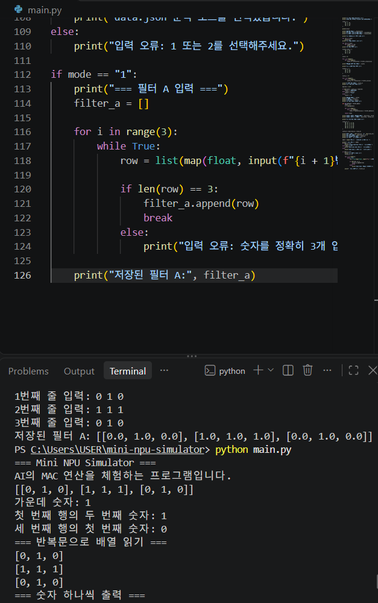
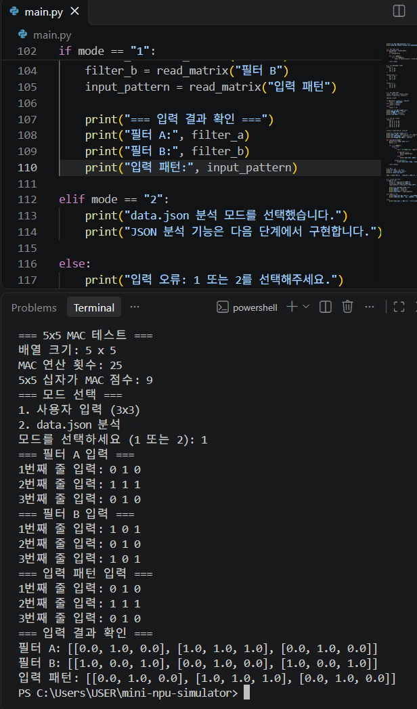
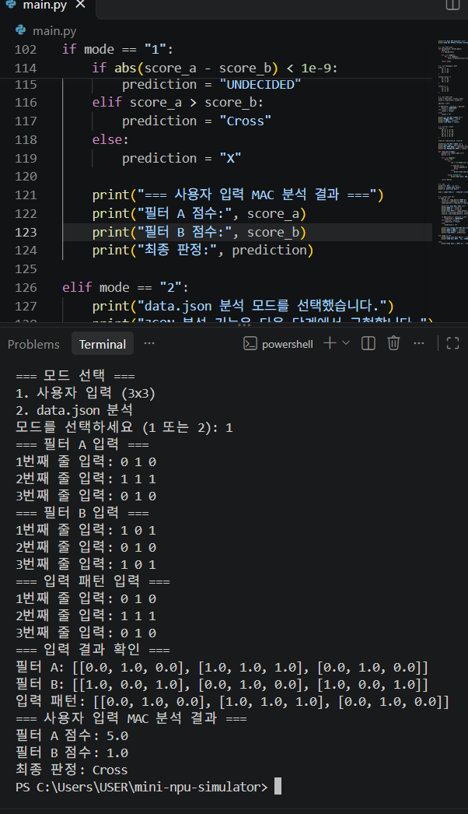

# Mini NPU Simulator — 코디세이 3주차 미션

## 1. 프로젝트 소개

Python으로 NPU(Neural Processing Unit)의 기본 연산인 MAC(Multiply-Accumulate, 곱셈-누적)을 구현하고, 입력 패턴과 두 필터(Cross, X)의 점수를 비교하는 콘솔 프로그램입니다. 외부 행렬 연산 라이브러리 없이 중첩 반복문을 사용합니다.

**실행 환경:** Windows, VS Code, Python 3.x  
**실행 명령:** `python main.py`

```text
mini-npu-simulator/
├── main.py
├── data.json
├── README.md
└── screenshots/
    ├── 03_MAC_연산_구현.png
    ├── 04_MAC_패턴_자동판정.png
    ├── 05_MAC_5x5_확장테스트.png
    ├── 06_입력값_개수검증_1.png
    ├── 06_입력값_개수검증_2.png
    ├── 07_문자입력_오류처리.png
    ├── 08_3x3_필터_패턴입력.png
    ├── 09_사용자입력_MAC_자동판정.png
    ├── 10_X패턴_MAC_판정.png
    ├── 11_UNDECIDED_동점판정.png
    └── 12_JSON_자동분석_성능측정.png
```

## 2. 실행 모드 및 입력 검증

`python main.py` 실행 후 다음 모드 중 하나를 선택합니다.

| 구분 | 모드 1: 사용자 입력 | 모드 2: JSON 자동 분석 |
|---|---|---|
| 입력 | 필터 A(Cross), 필터 B(X), 패턴을 각각 3×3으로 입력 | `data.json`의 5×5·13×13·25×25 패턴 6건 |
| 검사 | 행마다 숫자 3개, 숫자 변환 가능 여부 확인 | 크기에 맞는 필터를 찾아 점수 계산 |
| 판정 | Cross / X / UNDECIDED | Cross / X / UNDECIDED |
| 동점 의미 | 두 필터 중 어느 쪽인지 **판정 불가** | `UNDECIDED`로 출력하고 기대값과 불일치하면 FAIL |
| 성능 측정 | **추가 구현 필요:** 사용자 입력 완료 후 MAC 함수만 ms 단위 측정 | 크기별 MAC 함수 10회 측정 후 평균 ms 출력 |

모드 1은 `try/except ValueError`로 문자 입력을 처리하며, 숫자 개수가 3개가 아니어도 오류를 안내하고 다시 입력받습니다. 입력 횟수 제한은 두지 않았습니다.

### 모드 1 성능 측정의 목표 구현

모드 1에서도 **사용자 입력 대기 시간과 출력 시간은 제외**하고 MAC 계산만 측정해야 합니다. 필터 A 및 B에 대한 MAC 함수 호출 전후를 `time.perf_counter()`로 감싸고, 경과 시간에 `1000`을 곱해 ms로 출력합니다. 아래는 **추가할 구현 예시**이며, 현재 제출된 `main.py`에 이미 반영되었다는 뜻은 아닙니다.

```python
start = time.perf_counter()
score_a = mac(pattern, filter_a)
score_b = mac(pattern, filter_b)
elapsed_ms = (time.perf_counter() - start) * 1000
print(f"모드 1 MAC 계산 시간: {elapsed_ms:.6f} ms")
```

> `mac`은 예시 함수명입니다. 실제 `main.py`의 MAC 함수 이름과 인자 순서에 맞춰 적용해야 합니다. 두 필터 점수 계산을 포함하는 측정 구간이며 입력·출력은 포함하지 않습니다.

## 3. MAC 계산 및 판정 규칙

MAC은 대응하는 원소끼리 곱한 값을 누적합니다.

`MAC = Σ(pattern[i][j] × filter[i][j])`

중첩 반복문은 N×N 배열의 모든 원소를 순회하며, 필터 A와 B의 MAC 점수를 각각 계산합니다. 이 시뮬레이터에서 점수가 높을수록 **해당 필터와의 가중 합산 일치도가 높다**고 해석합니다. 단, MAC 점수 자체가 통계적으로 정규화된 유사도인 것은 아닙니다.

```python
if abs(score_a - score_b) < 1e-9:
    prediction = "UNDECIDED"
elif score_a > score_b:
    prediction = "Cross"
else:
    prediction = "X"
```

**동점 허용오차 `EPSILON = 1e-9`:** 부동소수점 연산에서는 수학적으로 같은 결과가 아주 작은 차이로 표현될 수 있으므로 절댓값 차이가 `1e-9` 미만이면 동점으로 간주합니다. 이는 이번 실습에 선택한 고정 절대 허용오차이지, 모든 데이터 크기와 값의 범위에서 검증된 최적 임계값은 아닙니다. 값의 스케일이 커지면 상대 허용오차 또는 `math.isclose()` 등을 검토할 수 있습니다.

### 모드별 동점 정책의 차이

- **모드 1:** 사용자가 직접 입력한 패턴의 두 점수가 동점이면 `UNDECIDED`를 표시합니다. 사용자 관점에서 이는 **'판정 불가'**와 같은 의미입니다. 요구 문구가 정확히 `판정 불가`라면 실제 출력 문자열도 그에 맞춰 수정해야 합니다.
- **모드 2:** 동일한 수치 기준으로 `UNDECIDED`를 반환하되, JSON의 `expected`와 비교하는 테스트이므로 예상 정답이 Cross/X라면 **FAIL**로 집계합니다. 이는 실행 예외가 아니라 기대값 불일치입니다.

## 4. JSON 데이터 구조와 정규화

`data.json`의 `filters`에는 `size_5`, `size_13`, `size_25`별 `cross`와 `x` 필터가 있으며, `patterns`의 각 항목에는 2차원 `input`과 예상 라벨 `expected`가 있습니다. 패턴의 행 개수 N으로 `size_N` 필터를 찾습니다.

현재 코드의 예상 라벨 처리 방식은 `+` 또는 `cross`를 `Cross`로, `x`를 `X`로 변환합니다. **현재 제출 코드에는 필터 키 정규화와 별도 `normalize_label()` 함수가 없다는 평가를 받았습니다.** 다음은 보완해야 할 설계입니다.

### 정규화 함수 분리 — 목표 설계

```python
def normalize_label(value):
    """사용자/JSON 라벨을 표준 라벨로 변환한다."""
    mapping = {"+": "Cross", "cross": "Cross", "x": "X"}
    return mapping.get(str(value).strip().lower())


def normalize_filter_key(value):
    """필터 이름을 JSON에서 사용하는 표준 키로 변환한다."""
    mapping = {"+": "cross", "cross": "cross", "x": "x"}
    return mapping.get(str(value).strip().lower())
```

두 함수는 **출력용 라벨**(`Cross`, `X`)과 **JSON 접근용 키**(`cross`, `x`)를 분리합니다. 이를 통해 대소문자·기호 차이를 일관되게 처리하고, 새 라벨을 추가할 때 매핑 규칙을 한곳에서 관리할 수 있습니다. 위 코드는 **구현 계획 예시**이며 `main.py`에도 실제로 반영하고 테스트해야 평가 항목 #5·#12의 코드 요건을 충족합니다.

필터 크기 키(`size_N`)가 없거나 라벨 정규화 결과가 `None`이면, 사용 가능한 키와 잘못된 입력값을 포함하는 오류 메시지를 출력하도록 개선할 수 있습니다. 비정방형 패턴도 각 행 길이를 검사해 오류를 안내하는 것이 바람직합니다.

### 새 라벨 추가 체크리스트

1. `data.json`에 새 필터 키와 해당 크기의 필터 행렬을 추가합니다.
2. `normalize_label()`의 입력 라벨 → 표준 출력 라벨 매핑을 확장합니다.
3. `normalize_filter_key()`의 입력 키 → JSON 필터 키 매핑을 확장합니다.
4. 점수 계산 및 판정 로직이 **두 필터 전용**인지 확인하고, 필요하면 다중 후보 비교로 확장합니다.
5. 결과 출력 문구, `expected` 비교 및 PASS/FAIL 집계가 새 라벨을 처리하도록 수정합니다.
6. `data.json`에 새 라벨의 정상·오류·동점 테스트 패턴을 추가합니다.
7. 실제 실행으로 예상 정답과 결과를 검증하고 README 예시를 갱신합니다.

## 5. JSON 자동 분석 결과

2026-11-19 실행 결과: **총 6건, PASS 3건, FAIL 3건**.

| 패턴 | MAC A | MAC B | 기대값 | 실제 판정 | 결과 |
|---|---:|---:|---|---|---|
| size_5_1 | 0.900000 | 0.900000 | X | UNDECIDED | FAIL |
| size_5_2 | 8.900000 | 0.100000 | Cross | Cross | PASS |
| size_13_1 | 0.300000 | 14.700000 | X | X | PASS |
| size_13_2 | 7.500000 | 7.500000 | Cross | UNDECIDED | FAIL |
| size_25_1 | 4.900000 | 4.900000 | X | UNDECIDED | FAIL |
| size_25_2 | 52.900000 | 0.100000 | Cross | Cross | PASS |

**FAIL 3건의 공통 원인:** 두 MAC 점수가 같아 `UNDECIDED`로 판정됐지만, JSON의 기대값은 Cross 또는 X로 지정되어 있습니다. 프로그램 오류가 아니라 **기대값과 판정 결과의 불일치**입니다. 기대값을 임의로 바꾸어 PASS로 만들지 않았습니다.

## 6. 성능 측정과 복잡도

모드 2에서는 `time.perf_counter()`를 사용해 **MAC 함수만** 각 크기별 10회 반복 측정하고 평균을 ms로 출력했습니다. JSON 읽기, 콘솔 출력, 사용자 입력 시간은 측정 대상에서 제외합니다.

| 배열 크기 | 원소별 MAC 횟수(N²) | 10회 평균(ms) |
|---|---:|---:|
| 5×5 | 25 | 0.004870 |
| 13×13 | 169 | 0.021990 |
| 25×25 | 625 | 0.131760 |

- **시간 복잡도:** N×N 배열을 모두 순회하므로 필터 하나당 `O(N²)`이며, 두 필터 비교도 상수 배만 늘어 `O(N²)`입니다.
- **추가 작업 공간:** 입력 행렬과 필터가 이미 메모리에 존재한다는 가정에서 MAC 누적 계산 자체는 합계 변수 등을 사용하므로 `O(1)`입니다. 입력 패턴과 필터 데이터를 보관하는 공간까지 포함하면 `O(N²)`입니다.
- **측정 한계:** 10회 평균은 실행 환경, 함수 호출·반복 오버헤드, OS 스케줄링에 영향을 받습니다. 매우 짧은 실행은 여러 번 반복한 총시간으로 측정하거나 반복 횟수를 늘리는 방법이 더 안정적입니다.

### 1000×1000 규모에서 예상되는 문제

1000×1000 패턴은 **100만 개 원소**를 포함합니다. 필터 하나의 MAC에 약 100만 회 곱셈·누적이 필요하며, 두 필터를 비교하면 약 200만 개 원소 위치를 처리합니다. 실제 처리 시간은 실행 환경과 자료구조에 따라 달라지므로 **측정하지 않은 실행 시간을 단정하지 않습니다.**

메모리 측면에서 원소가 64비트 실수로 **연속 저장된다면** 행렬 하나의 순수 수치 데이터는 약 8 MB(10진 기준)입니다. 그러나 Python의 중첩 리스트와 개별 숫자 객체는 참조·객체 오버헤드 때문에 실제 메모리 사용량이 이보다 클 수 있습니다. 패턴과 필터 여러 개를 동시에 보유하면 메모리 부담도 증가합니다.

**우선 검토할 최적화 순서:**

1. 불필요한 데이터 복사와 반복적인 형 변환을 줄이고, 행 우선 순회 등 **메모리 접근 패턴**을 개선합니다.
2. 큰 배열을 **블록(타일)** 단위로 나눠 캐시 재사용을 높입니다.
3. 계산량이 충분히 클 때 **벡터화·병렬화**를 검토합니다. 이 실습의 순수 Python 중첩 반복문만으로는 하드웨어 병렬성을 충분히 활용하기 어렵습니다.
4. 성능 개선 전후를 동일한 데이터·환경에서 반복 측정하고, 계산 시간뿐 아니라 메모리 사용량도 비교합니다.

### CPU와 NPU의 처리 특성 및 병목

| 비교 항목 | CPU | NPU |
|---|---|---|
| 기본 강점 | 범용 제어 흐름, 다양한 연산과 분기 처리 | 다수의 MAC을 병렬 수행하는 행렬·텐서 연산 |
| 병렬성 | 코어·SIMD 명령을 이용한 병렬 처리 가능 | 다수의 연산 유닛으로 대량 MAC 병렬화에 특화 |
| 주요 병목 | Python 인터프리터 오버헤드, 메모리 접근, 캐시 미스 등 | 메모리 대역폭, 데이터 이동, 온칩 메모리 용량, 연산 유닛 활용률 등 |
| 작은 작업 | 데이터 준비·호출 오버헤드가 상대적으로 작을 수 있음 | 데이터 전송·실행 준비 비용 때문에 항상 빠르지는 않음 |
| 큰 작업 | 최적화하지 않은 순차 루프는 느려질 수 있음 | 데이터 재사용과 병렬성이 충분하면 높은 처리량 기대 |

CPU가 반드시 직렬 처리만 하는 것은 아닙니다. CPU도 멀티코어·SIMD로 병렬 연산을 수행합니다. 반대로 NPU도 **메모리에서 데이터를 공급하는 속도**가 연산 유닛의 소비 속도를 따라가지 못하면 성능이 제한됩니다. 따라서 대규모 MAC에서는 연산 횟수뿐 아니라 데이터 이동량, 메모리 대역폭, 타일링 및 병렬 활용률이 중요합니다.

> 본 프로젝트는 **Python 콘솔 기반 NPU 연산 원리 시뮬레이터**입니다. 실제 NPU 하드웨어를 구동하거나 CPU와 NPU의 성능을 직접 비교 측정한 실험은 아닙니다.

## 7. 트러블슈팅

### 7-1. IndentationError

- **원인:** `try`와 `except`의 들여쓰기 수준이 일치하지 않음.
- **해결:** 공백 4칸을 기준으로 코드 블록의 들여쓰기를 정리함.
- **배운 점:** Python에서는 들여쓰기가 코드의 실행 범위를 결정함.

### 7-2. PowerShell 입력 오류

- **원인:** Python 프로그램 입력 대기 상태가 아닌 PowerShell 프롬프트에 `a b c`를 입력함.
- **해결:** `python main.py` 실행 후 프로그램이 값을 요청할 때 입력함.
- **배운 점:** 셸 명령어와 프로그램의 표준 입력을 구분해야 함.

### 7-3. 다른 main.py 파일 실행

- **원인:** Downloads 폴더와 프로젝트 폴더에 각각 `main.py`가 있어 이전 파일을 실행함.
- **해결:** 완성 코드를 프로젝트 폴더의 `main.py`에 복사·저장하고 실행 경로를 확인함.
- **배운 점:** 같은 파일명이라도 경로가 다르면 다른 파일임.

## 8. 실습 증빙 이미지

### MAC 연산 구현


### Cross/X 패턴 자동 판정


### 5×5 확장 테스트


### 입력값 개수 검증



### 문자 입력 오류 처리


### 3×3 필터 및 패턴 입력


### 사용자 입력 MAC 자동 판정


### X 패턴 판정


### UNDECIDED 동점 판정


### JSON 자동 분석 및 성능 측정


## 9. 배운 점 및 후속 개선

2차원 배열, 중첩 반복문, 함수 재사용, 예외 처리, JSON 데이터 로딩, 부동소수점 허용오차, 테스트 기대값 비교 및 반복 성능 측정을 실습했습니다. 특히 **프로그램 실행 성공과 테스트 기대값 일치는 서로 다른 기준**이라는 점을 확인했습니다.

**추가 구현 및 재검증이 필요한 항목:** 모드 1의 MAC 시간 측정, `normalize_label()`·`normalize_filter_key()`의 실제 코드 적용, 모드 1의 '판정 불가' 출력 요구사항 확인입니다. 이 항목들은 README 설명만으로 구현이 완료되지 않으며, `main.py`를 수정한 뒤 다시 실행·검증해야 합니다.
